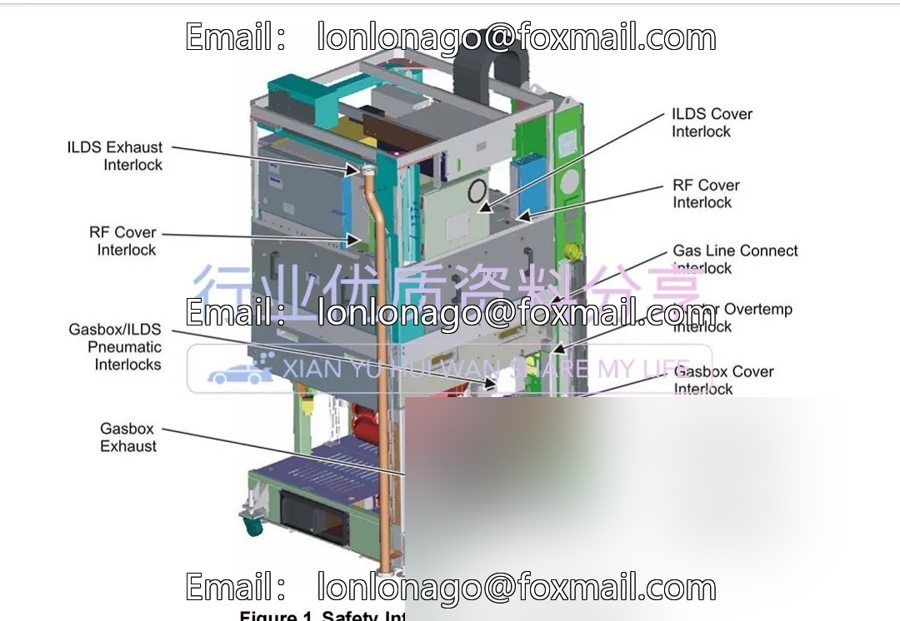
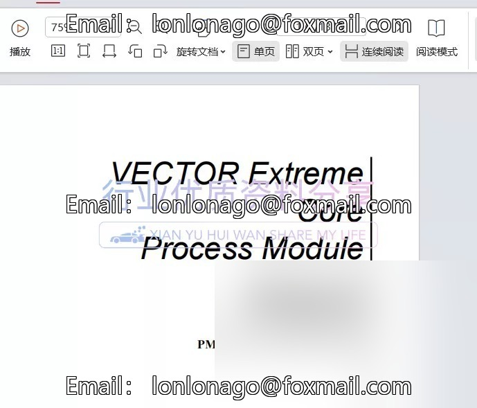

# LAM PECVD data: VECTOR Extreme Cor

## Body

LAM PECVD data: Vector Extreme Core Process Module manual 1375 pages

Capture and send the electronic original directly! The following images include screenshots of the file portion. Please confirm before placing the order! Due to the replicable nature of electronic documentation Therefore, are allowed after purchase! Thanks for understanding!

For personal learning and reference use only.

The materials are LAM PECVD VECTOR Extreme Cor, covering the VECTOR Extreme Core Process Module handbook and 1,375 pages; images show ILDS, Interlock, Echo, Gas Line Connect, Pneumatic, Core and other file covers.

<!-- AI_ENRICHED -->

## Images

## Payment

Here is a pay link on Stripe ( https://buy.stripe.com/3cs8yP7sY87d0vu9AB ). Please contact me lonlonago@foxmail.com after funding $89, and I will send you a complete data files , thank you!

